<p align="center">
  <a href="https://z3n1337.dev">
    
  </a>
</p>

<p align="center">
  <a href="https://z3n1337.dev">
    
  </a>
</p>

<p align="center">
  <a href="https://z3n1337.dev"></a>
  <a href="https://x.com/z3n_ghoul"></a>
  <a href="https://t.me/z3n_ghoul"></a>
  
  <a href="https://steamcommunity.com/profiles/76561198985617990"></a>
</p>

---

## ✦ whoami

```js
const z3n = {
  aka:       ["z3n", "z3n1337", "z3n_ghoul", "elf"],
  role:      "software engineering student",
  location:  "somewhere in ukraine",
  pronouns:  "he/him",
  fuel:      ["monster", "another monster", "yet another monster..."],
  sleep:     null,            // 404: sleep not found
  timezone:  "Europe/Kyiv",   // UTC+2, UTC+3 in summer
  building:  "z3n1337.dev",   // a tiny pixel night sky with my links in it
};
```

## ✦ my coding buddy

<p align="center">
  <a href="https://claude.com/claude-code"></a>
</p>

## ✦ stuff i use

<p>
  
  
  
  
  
  
  
  
</p>

## ✦ featured

<table>
  <tr>
    <td>
      <a href="https://github.com/z3nghoul/repo-sniff">
        
      </a>
    </td>
  </tr>
  <tr>
    <td>
      <b><a href="https://github.com/z3nghoul/repo-sniff">repo-sniff</a></b> · sniff a repository before you run it.
      a static scanner in rust that looks for malicious code in a github repo
      before you <code>npm install</code> it, open it in vs code or build it, and never runs a thing from it.
      21 rules: trojan source, vs code auto-run tasks, npm hooks, python <code>.pth</code>, obfuscated js loaders,
      powershell droppers, disguised <code>.exe</code>. 0 false criticals on ripgrep, cargo, vscode, node and react.
      <br><br>
      <a href="https://github.com/z3nghoul/repo-sniff/releases/tag/v0.1.0"></a>
      
      
    </td>
  </tr>
</table>

## ✦ stats

<p align="center">
  
  
</p>

---

<p align="center">
  
  <br>
  <sub>made with 💜 and too many monsters · somewhere in ukraine</sub>
</p>
